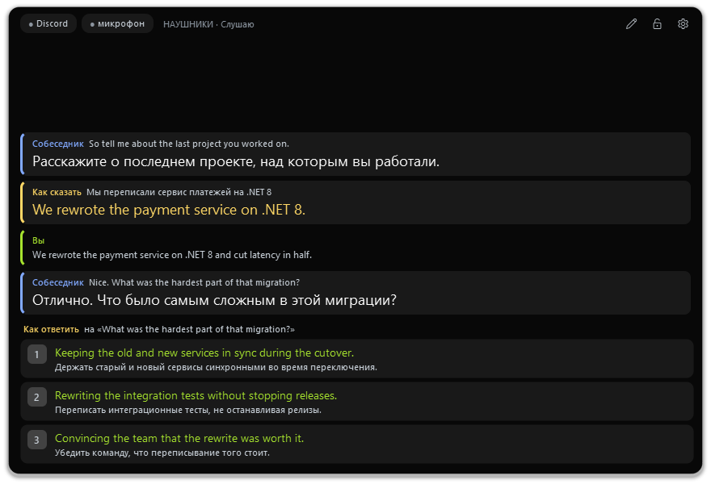

# Call Translator: оверлей-переводчик для звонков

Работает поверх любого приложения: Discord, Zoom, Teams, Google Meet, Telegram, WhatsApp. Всё считается на вашем компьютере, звук никуда не отправляется.

- **Собеседник говорит по-английски.** Вверху серым показан его английский текст, ниже крупно — русский перевод.
- **Вы говорите или пишете по-русски.** Оверлей показывает английскую фразу (жёлтым), которую можно сказать.
- **Вы говорите по-английски.** Ваша фраза показывается зелёным, чтобы было видно, как её распознали. Она же используется как контекст для подсказок.
- **Ctrl+Alt+S** — 3 варианта ответа по ходу разговора, **Ctrl+Alt+1..3** — скопировать вариант в буфер (удобно для чата).
- Оверлей **не виден собеседнику при демонстрации экрана** (Windows 10 2004+).

## Что нужно

- Windows 10/11, **Python 3.12** (подойдут 3.11–3.13; более новые версии пока не поддерживаются библиотеками распознавания речи). При установке поставьте галочку «Add python.exe to PATH». Если стоит более новый Python, удалять его не нужно: `install.bat` сам найдёт 3.12 рядом.
- [Ollama](https://ollama.com) — локальная нейросеть для перевода.
- Желательно видеокарта NVIDIA с 6–8 ГБ памяти. Без неё всё работает, но медленнее: Whisper `small` на процессоре, перевод через Ollama на процессоре.
- **Наушники.** Если звук идёт из динамиков, микрофон слышит собеседника и его речь задваивается.

## Установка

1. Установите Python 3.12.
2. Запустите `install.bat`: он создаст окружение, поставит зависимости, при наличии NVIDIA добавит CUDA-библиотеки, **сам скачает и установит Ollama**, если её нет (на тот же диск, где лежит программа), и скачает модель `gemma3:4b`.
3. Запустите `run.bat`. При первом запуске скачивается модель Whisper (~1,6 ГБ для large-v3-turbo).

## Место на диске

Всё тяжёлое хранится на том же диске, где лежит программа, а не на C:

| Что | Где | Размер |
|---|---|---|
| Python-окружение с CUDA | `CallTranslator\.venv` | ~3–4 ГБ |
| Модели Whisper | `CallTranslator\models` | ~1,6 ГБ |
| Модели Ollama | `E:\Ollama\models` (переменная `OLLAMA_MODELS`) | 3,3 ГБ (gemma3:4b), 8 ГБ (gemma3:12b) |

- Ollama, если её не было, `install.bat` ставит в папку `Ollama` на том же диске, где лежит программа. Если ставите вручную, укажите диск сами: `OllamaSetup.exe /DIR="E:\Ollama"`.
- Python можно установить на E: в установщике выберите «Customize installation» и укажите папку.
- pip-кэш отключён, временные файлы установки кладутся в `CallTranslator\tmp` и удаляются после установки.
- Если модели Ollama уже скачаны на C (`C:\Users\<вы>\.ollama\models`), закройте Ollama и перенесите содержимое этой папки в `E:\Ollama\models`.

## Управление

| Клавиши | Действие |
|---|---|
| Ctrl+Alt+O или кнопка ⚙ | Окно настроек |
| Ctrl+Alt+T или кнопка-замок | Закрепить или открепить. В закреплённом режиме клики проходят сквозь оверлей в окно звонка |
| Ctrl+Alt+S | Варианты ответа |
| Ctrl+Alt+1..3 или клик по варианту | Скопировать вариант |
| Ctrl+Alt+I или кнопка ✎ | Поле ввода: напишите по-русски и нажмите Enter (Esc — скрыть) |
| Ctrl+Alt+R | Выбрать область текстового чата, за которой следить |
| Ctrl+Alt+M | Голосовой ввод вкл/выкл |
| Ctrl+Alt+H | Спрятать или показать |
| Ctrl+Alt+C | Очистить |
| Ctrl+Alt+Q | Выход |

В откреплённом режиме окно двигается мышью за шапку, размер меняется за уголок справа внизу, по правому клику открывается меню. Положение окна запоминается.

### Как читать оверлей

- **Синяя полоса** — собеседник: сверху мелко его английский, ниже крупно перевод.
- **Зелёная полоса** — вы говорили по-английски (как вас распознало).
- **Янтарная полоса «Как сказать»** — ваша русская фраза и английский вариант, который можно произнести.
- **Шапка:** точка у источника звука горит зелёным, когда звук собеседника доходит до программы; точка у микрофона — когда доходит ваш голос.
- **Предупреждения** (нет Ollama, модель на процессоре и т.п.) появляются янтарной плашкой под шапкой; её можно закрыть крестиком.
- На экране показываются только реплики, которые помещаются целиком: старые уходят вверх, а не обрезаются посередине.

На вкладке **«Вид»** в настройках можно выбрать тему (тёмная, светлая, контрастная), размер текста, прозрачность фона, сколько реплик держать на экране и показывать ли английский оригинал. Изменения видны сразу, «Отмена» возвращает как было.

## Окно настроек (⚙ или Ctrl+Alt+O)

Настройки применяются сразу, без перезапуска, и сохраняются в `user_settings.json` (файл создаётся при первом сохранении и не попадает в git). Пример со всеми полями — `user_settings.example.json`: его можно скопировать в `user_settings.json` и поправить вручную.

### Звук собеседника: какое окно переводить

- **Все устройства вывода** (по умолчанию) — наушники, динамики и гарнитура слушаются одновременно. Звук звонка найдётся, даже если Windows переключила беспроводную гарнитуру в режим «Hands-Free» или звонок идёт на «устройство связи».
- **Только устройство вывода по умолчанию** — как было раньше.
- **Конкретное окно** (Discord, Zoom, Teams, Telegram, WhatsApp, браузер с Meet). Переводится только звук этого приложения, а видео, игры и уведомления в субтитры не попадают. Если приложение перезапустить, оверлей подключится к нему заново сам.
- **Конкретное устройство вывода** — если звонок идёт не в устройство по умолчанию.

Захват окна работает на Windows 11 (и Windows 10, начиная со сборки 20348). Если система его не поддерживает, оверлей напишет об этом и переключится на все устройства вывода. У браузера захватывается звук всех вкладок сразу.

### Голосовой ввод

- **Микрофон** — выбор из списка.
- **Режим**:
  - *Выключен* — только субтитры собеседника.
  - *Всегда слушать* — распознаётся всё, что вы говорите.
  - *Только пока держу клавишу* (по умолчанию Right Ctrl, можно назначить свою кнопкой «Назначить…»). Держите клавишу, скажите фразу по-русски, отпустите — появится английский вариант.
- **Ваш язык** — русский и английский автоматически, либо только один из них (так точнее).

### Чат (текст): если собеседник пишет, а не говорит

1. Нажмите **Ctrl+Alt+R** (или ⚙ → «Чат (текст)» → «Выбрать область чата…», или правый клик по оверлею).
2. Экран затемнится — обведите рамкой область с сообщениями в окне Discord, Telegram, Zoom, WhatsApp или браузера.
3. Готово: в шапке появится «● чат». Новые английские сообщения собеседника будут появляться в ленте с пометкой **«Собеседник · чат»** (пунктирная синяя полоса), на вопросы — варианты ответа.

Как это устроено:

- Область привязана к окну приложения: окно можно двигать и перекрывать другими окнами — оверлей всё равно его видит. Если окно свернуть, слежение приостанавливается (точка «чат» станет жёлтой). Если поменяли размер окна чата — выберите область заново.
- Текст распознаётся встроенным распознаванием Windows (быстро, нужен английский язык в Windows). Если его нет — автоматически используется RapidOCR (при первом запуске скачается модель ~9 МБ).
- То, что уже было в чате на момент запуска, не переводится — только новые сообщения. Время, «печатает…», имена авторов и прокрутка истории пропускаются.
- Ваши сообщения пропускаются: русские — всегда, английские — если вы брали их из подсказок, вариантов ответа или писали в поле ✎.
- Распознавание запускается только когда в чате что-то изменилось, поэтому нагрузка на процессор небольшая.

### Подсказки ответов

Режим выбирается на вкладке «Подсказки ответов»:

- **Автоматически, когда собеседник задаёт вопрос** (по умолчанию). Под субтитрами появляется «Как ответить на: «вопрос»» и 3 варианта: короткий ответ, развёрнутый и вежливый способ взять паузу или уточнить.
- **После каждой фразы собеседника** — варианты реакции на любую реплику.
- **Только по клавише Ctrl+Alt+S** — если последний вопрос ещё без ответа, подсказки будут именно к нему.

Ctrl+Alt+1…3 копирует вариант в буфер. Когда вы читаете вариант вслух, оверлей подсвечивает его (▶), а дочитанный отмечает галочкой (✓). Подсказки не исчезают и не меняются, пока вы говорите: новые варианты появятся через пару секунд после того, как вы замолчите. Если вопросы идут один за другим, подсказки подбираются к самому свежему.

Поле **«О себе»** (роль, проект, чем занимаетесь) помогает отвечать на вопросы про вас. Чего модель не знает, она не выдумывает, а оставляет в квадратных скобках, например «[дата]».

### Как сказать фразу по-русски, чтобы собеседник её не услышал

**Вариант 1 — виртуальный кабель (удобнее всего):**

1. Установите бесплатный [VB-Cable](https://vb-audio.com/Cable/) и перезагрузите компьютер.
2. В настройках оверлея включите «Скрывать русскую речь от собеседника», выберите вывод «CABLE Input» и режим «Только пока держу клавишу».
3. В Discord, Zoom или Telegram выберите микрофоном **CABLE Output**.

Теперь ваш голос идёт в звонок через оверлей. Пока вы держите клавишу, собеседник вас не слышит, а оверлей переводит сказанное. Если закрыть оверлей, собеседник вас тоже не услышит — верните в звонке обычный микрофон.

**Вариант 2 — без установки:** пишите по-русски в поле ввода (Ctrl+Alt+I) или выключайте микрофон в самом звонке, пока говорите фразу.

## Настройка (`config.toml`)

- **Видеокарта на 6–8 ГБ** (RTX 3050/3060 Ti/4060) — программа подстраивается сама:
  - распознавание речи переходит в экономный режим (int8);
  - модель перевода загружается только после распознавания, чтобы распознавание точно осталось на видеокарте;
  - Ollama работает с коротким контекстом, одним запросом за раз и сжатым кэшем (`install.bat` прописывает это и для Ollama из трея);
  - если модель перевода всё равно не помещается целиком, программа один раз перезапускает Ollama в экономном режиме, а если и это не помогло — сама переходит на модель поменьше `qwen2.5:3b` (~2 ГБ) и запоминает выбор. Чтобы вернуться к основной модели, удалите строки `llm_model` из `user_settings.json`.
- **Слабая видеокарта или не хватает памяти:** `model = "small"` или `"medium"`, `compute_type = "int8_float16"`, а в `[llm]` — `model = "gemma3:1b"` или `"qwen2.5:3b"` (перевод будет хуже).
- **Видеокарта на 12 ГБ и больше:** `[llm] model = "gemma3:12b"` — заметно лучше перевод и подсказки.
- **Слышит не тот микрофон или не тот звук:** выберите нужные в окне настроек (⚙).
- **Ловит шум:** поставьте `energy_threshold = 0.03`.
- **Фразы рвутся на середине:** увеличьте `silence_ms` до 800–1000.

## Если что-то не работает

- **Своя речь распознаётся, а речь собеседника — нет.** Посмотрите на значок 🔊 в шапке оверлея: когда собеседник говорит, он должен загораться зелёным. Если не загорается — программа слушает не то устройство: в настройках (⚙) выберите «Все устройства вывода» или окно приложения звонка. Чтобы точно найти устройство, нажмите ⚙ → «Проверка звука…»: там видно уровень звука на каждом устройстве, и кнопкой «Слушать это» можно выбрать нужное.
- **Звук есть, а субтитров нет.** Программа раз в 10 секунд пишет в `diag.log` (в папке программы), сколько звука пришло с каждого устройства, какой был пик громкости, какой порог речи, сколько фраз нарезано и что распознано. Пришлите этот файл — по нему видно, где теряется звук.

- **«Не удалось на cuda…», дальше работает на CPU:** не загрузились CUDA-библиотеки. Выполните `.venv\Scripts\pip install -r requirements-gpu.txt` и обновите драйвер NVIDIA.
- **«Ollama не запущена»:** запустите Ollama (значок в трее). **«Нет модели»:** выполните `ollama pull gemma3:4b`.
- **Нет субтитров собеседника:** оверлей слушает устройство вывода по умолчанию. Если звонок идёт в другое устройство (например, гарнитуру), укажите его в `loopback_device` или сделайте его устройством по умолчанию. Смена устройства по умолчанию подхватывается только после перезапуска.
- **Горячие клавиши не работают, когда активно окно, запущенное от администратора:** это ограничение Windows, запустите `run.bat` от администратора.

## Ограничения

- Задержка субтитров — примерно 1–2 секунды после конца фразы. Черновик (серый курсив) появляется прямо во время речи, если работает видеокарта.
- Перебивания и одновременная речь нескольких собеседников распознаются хуже.
- В режиме «Весь звук системы» в субтитры попадает всё, что играет. Чтобы этого не было, выберите окно звонка в настройках.
